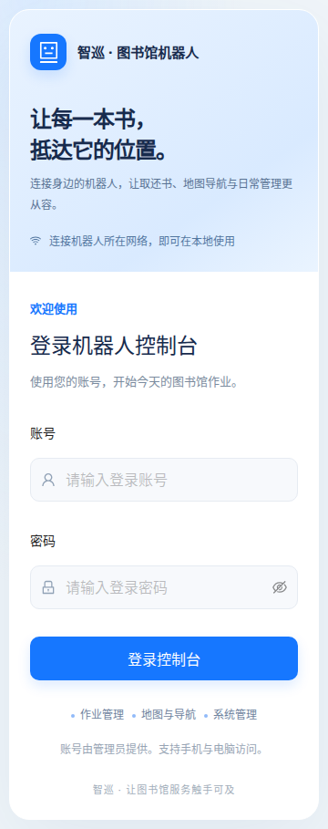
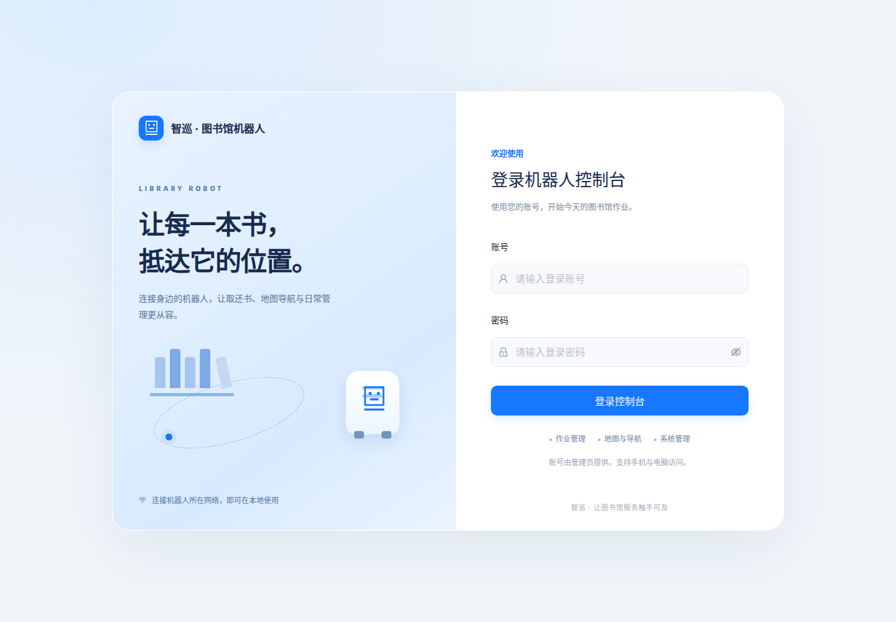

# 图书馆机器人用户使用指南

适用对象：使用手机、平板或电脑操作图书馆机器人的工作人员。

更新日期：2026 年 10 月 24 日。

## 一、正式使用：连接机器人自己的热点

用户无需进入车载电脑桌面。首次使用可通过 **机器人热点 → 手机或电脑连接热点 → 浏览器登录控制台** 接入；日常使用也可在“系统 → 网络连接”中把机器人切换到图书馆 Wi-Fi，随后通过同一局域网控制。两种方式均不要求连接互联网。

**机器人当前使用哪种网络，以“系统 → 网络连接”的当前连接为准。** 已确认保存图书馆 Wi-Fi 后，开机优先连接该网络；单网卡此时通常不会同时广播机器人热点。切换方法见第九节。

| 项目 | 热点接入信息 |
| --- | --- |
| 连接网络 | 车载电脑提供的 Wi-Fi 热点 `图书馆机器人` |
| 热点密码 | `12345678` |
| 浏览器地址 | `http://192.168.4.1:8000` |
| 网站账号 | `operator`，或管理员单独发放的账号 |
| 网站密码 | `123456`（当前普通操作账号密码；若管理员修改，以新密码为准） |
| 可用模块 | 作业、地图与导航、系统 |

**快速上手：连接网络 → 浏览器输入完整地址 → 登录 → 查看“运行总览” → 选择需要的功能。**

热点地址固定为 `192.168.4.1`，网页统一使用 `8000` 端口，`8001` 已停用。热点不保证提供互联网；如果手机提示“此网络无互联网”，请选择保持连接。连接图书馆 Wi-Fi 后，机器人的新地址由路由器分配，不再固定为 `192.168.4.1`。

## 二、手机和平板连接步骤

1. 确认机器人已开机，且管理员已完成热点启用与验收。
2. 打开设备的 Wi-Fi 设置，连接“图书馆机器人”，输入热点密码 `12345678`；如提示无互联网，选择保持连接。
3. 打开系统浏览器，在顶部地址栏输入 `http://192.168.4.1:8000`，点击前往。
4. 出现“登录机器人控制台”页面后，输入网站账号和密码，点击“登录控制台”。
5. 登录后进入“运行总览”。点击左上角的菜单图标，可展开“作业”“地图与导航”“系统”。
6. 页面支持竖屏使用；查看地图或较宽的内容时，可以把设备旋转为横屏。

请在浏览器的**地址栏**输入地址，不要输入到搜索网站的搜索框。完整保留 `http://` 和结尾的 `:8000`。

## 三、电脑连接步骤

1. 在管理员确认热点已启用后，通过 Wi-Fi 连接“图书馆机器人”，输入热点密码 `12345678`。
2. 打开浏览器，在地址栏输入 `http://192.168.4.1:8000`。无需安装专用客户端。
3. 输入网站账号和密码，点击“登录控制台”。
4. 在左侧菜单选择所需模块。窗口较窄时，菜单可能折叠，点击左上角图标展开。
5. 可以把该地址加入浏览器书签，便于下次使用；若机器人地址发生变化，应同步更新书签。

在其他手机、电脑上，不要输入 `localhost:8000` 或 `127.0.0.1:8000`；这些地址指向正在使用的手机或电脑自身，不能访问车载电脑。

## 四、登录与退出

### 登录

- 当前普通操作账号为 `operator`，网站密码为 `123456`；管理员修改后使用新密码。
- 密码区分大小写，复制时请勿带入空格。
- Wi-Fi 密码只用于连接网络，不能代替网站登录密码。
- 系统没有面向普通用户的自行注册入口；账号问题请联系管理员。

普通账号不显示“调试中心”。直接输入调试页面地址也不能取得调试权限，这属于正常权限设置。

### 退出

1. 确认当前作业已完成或已按现场要求妥善处理。
2. 点击页面右上角的用户头像。
3. 选择“退出登录”，确认页面回到登录界面。

**退出登录、关闭网页或断开 Wi-Fi，都不是取消机器人作业的指令。** 不要以关闭浏览器代替“取消任务”或“停止导航”。

网站会话有效期为 24 小时；控制服务重启后也需要重新登录。多人轮换使用公共电脑时，请交接后退出账号。

## 五、开始操作前查看运行总览

进入 **作业 → 运行总览**，依次查看：

1. 页面顶部是否显示“控制站已连接”。
2. 目标机器人是否在线，电量和告警是否需要处理。
3. 机器人是否已有任务、是否正在建图、是否处于急停锁定或故障状态。
4. 执行导航前，确认当前地图与实际场地一致，定位状态已就绪。

网页可以打开并不代表所有硬件已经就绪。显示“正在重连控制站”“控制站需检查”或其他异常时，请先处理连接或联系管理员。

同一时间由一名指定操作员控制同一台机器人，其他人查看状态，避免从多个设备同时下发相互冲突的动作。

## 六、作业：取书、还书与书籍管理

### 1. 快速取书

进入 **作业 → 快速取书**：

1. 选择已登记的目标书籍。
2. 核对目标书架或地图标注点、取书高度，以及放入的书立槽位。优先使用管理员已登记的数据。
3. 核对“发送导航”选项：勾选时先导航到目标点；不勾选时底盘不导航，直接原地执行升降与取书。
4. 确认路径及机械臂运动范围内无人、无障碍物，点击“开始完整取书”，阅读并确认页面提示。
5. 在“当前取书任务”中查看进度与结果，等待任务完成。

**取消“发送导航”不表示只做预览。** 机器人仍可能执行升降和机械臂动作，只有确认机器人已位于正确作业位置时才使用原地作业。

### 2. 快速还书

进入 **作业 → 快速还书**：

1. 按管理员指导，确认待还图书已经位于指定的书立槽位。
2. 选择还书模式及书架上的目标书籍，核对导航点、高度与取书槽位。
3. 页面中的“中位还书”按所选书籍确定插入位置；“末尾还书（测试）”仍带测试标识，仅在管理员完成现场验证并指导后使用。
4. 核对“发送导航”，点击“开始完整还书”，确认后查看任务进度。

### 3. 多轮取还书

进入 **作业 → 多轮取还书**，按页面选择取书列表和还书目标，核对顺序、导航点、高度以及书立槽位，再点击“开始多轮取还书”。

槽位与列表顺序有对应关系，请按页面说明摆放图书；首次使用时由管理员指导确认。等待当前任务结束后再发起下一次作业。

### 4. 书籍管理

进入 **作业 → 书籍管理**，查看、登记和维护书籍信息。书名、识别图片、书架位置、高度和槽位信息会影响实际作业，应依据现场图书和管理员确认的数据填写。

若取还书页面没有可选书籍，请先检查书籍是否已登记，不要临时猜测高度或坐标。

### 5. 取消或失败

- 需要中止作业时，在当前任务中点击“取消任务”，阅读提示并确认。
- 取消请求发出后，继续观察机器人和页面状态，不要仅凭按钮点击判断已经停止。
- 任务失败时记录错误提示，联系管理员；不要反复点击开始或用修改参数的方式强行重试。
- 取消或失败后，机械臂可能仍夹着书停在中途，由现场人员确认并处理后再继续。

## 七、地图与导航

### 查看地图与导航到标注点

进入 **地图与导航 → 地图建模**：

1. 选择目标机器人实际使用的地图，查看机器人位置及朝向。
2. 确认定位已就绪，显示位置与机器人实际位置一致。
3. 选择管理员已确认的地图标注点，使用“导航”操作，并确认弹窗。
4. 查看“标注导航进度”。需要中止时点击“停止导航”，观察停止结果。

不确定机器人实际位置时，先联系管理员确认定位，不要随意选择一个地图位置继续导航。切换地图会取消在途任务并需要重新定位，日常操作不要把“切换到此地图”当作普通查看按钮。

### 手动建图

进入 **地图与导航 → 手动建图**。该功能用于采集或更新场地图，建议由接受过现场培训的工作人员操作：

1. 确认没有正在执行的取还书或导航任务。
2. 点击“开始建图”并确认。建图期间导航停止，取还书、导航等依赖导航的任务不可用。
3. 使用本页“建图遥控”的方向按钮，按住移动，松开停止，并观察实时建图预览。
4. 完成扫描后，先点击“保存地图并入库”。
5. 确认保存成功，再点击“结束并恢复导航”。

建图遥控与“系统 → 机器人控制”属于不同工作模式，请使用当前模式对应页面的控制按钮。

## 八、系统：查看设备与手动控制

系统菜单包含“网络连接”“机器人管理”和“机器人控制”。手机上点击左上角菜单图标展开；选择页面后菜单收起。网络连接的完整步骤见第九节。

### 机器人管理

进入 **系统 → 机器人管理**，查看机器人列表和设备信息。新增或删除机器人前，请与管理员确认，避免影响正在使用的设备记录。

### 机器人控制

进入 **系统 → 机器人控制**，选择目标机器人，点击“手动控制”，按页面提示操作：

| 操作 | 手机或平板 | 电脑 |
| --- | --- | --- |
| 前进、后退、左转、右转 | 按住对应方向按钮，松开停止 | 按住页面按钮，或使用页面支持的键盘按键 |
| 键盘方向 | 不适用 | `W` / `↑` 前进，`S` / `↓` 后退，`A` / `←` 左转，`D` / `→` 右转 |
| 停止当前手动移动 | 点击“立即停止” | 点击“立即停止”或按空格键 |

手动控制时保持机器人在视野内，结束后确认车辆已停止。网页失去连接时不要继续发送动作；有危险时优先使用机器人实体急停。网页上的“请求紧急停止”依赖网络和控制服务，不能替代实体急停。

软件急停锁定的解除由管理员处理。普通用户没有解除入口时，请联系管理员，不要尝试绕过。

## 九、网络连接：切换到图书馆 Wi-Fi

### 切换前准备

先停止手动控制，结束取还书、导航和建图，确认机器人已停止；有正在执行、排队或暂停的任务时，系统会拒绝切换。准备目标 Wi-Fi 名称和密码，并确认手机或电脑也能连接它。覆盖范围取决于图书馆路由器与无线接入点；机器人必须始终处于该网络覆盖范围内。

目标网络需要允许局域网设备互访。支持开放网络及 WPA/WPA2/WPA3 个人网络；需要企业账号/证书、网页认证的网络，以及禁止设备互访的访客网络，请由网络管理员处理。

### 从热点切换到 Wi-Fi

1. 通过机器人热点登录控制台，打开 **系统 → 网络连接**。
2. 在“可用 Wi-Fi”中选中目标网络并点击“连接”。热点模式下，为避免扫描打断现有连接，页面只显示缓存网络；找不到时点击“手动添加网络”，准确填写 Wi-Fi 名称、安全类型和密码，隐藏网络需勾选对应选项。
3. **先记下页面显示的名称入口**，例如本机 `http://lr-control.local:8000/system/network`。其他机器人以各自页面显示为准；若设备不支持 `.local`，提前准备通过路由器客户端列表查询车载电脑 IP。
4. 输入的是目标 Wi-Fi 密码，不是网站密码。阅读并勾选切换提示，点击“确认并切换”。系统约 5 秒后开始切换，当前网页暂时断开属于正常现象。请勿连续重复提交。
5. 在手机或电脑的系统 Wi-Fi 设置中连接同一个目标 Wi-Fi，然后打开第 3 步记下的入口。名称打不开时，查询路由器为机器人分配的新 IPv4 地址，访问 `http://新IP:8000/system/network`。不要继续使用旧热点地址。
6. 不同地址首次访问需要重新登录，仍使用原网站账号。进入“系统 → 网络连接”，**在切换开始后约 5 分钟内点击“确认保留此连接”**，以页面倒计时为准。
7. 出现“连接已保留”后，网络配置和密码保存到车载电脑，后续开机优先自动连接。手机、平板、电脑都可通过该局域网地址继续使用原有功能。

如果密码错误或约 45 秒仍未取得 IP，会尝试恢复原连接；如果已连接但未及时确认，也会恢复原连接。恢复后让手机或电脑重新连接原热点或原 Wi-Fi，再尝试访问。若提示“恢复请求未完成”，等待网络检查点超时恢复；仍不恢复请联系现场维护人员。

### 切回机器人热点

在网络页面的“当前连接”卡片中点击“切回机器人热点”，阅读并确认提示。随后让手机或电脑连接“图书馆机器人”（默认热点密码 `12345678`），打开 `http://192.168.4.1:8000/system/network`，重新登录并及时点击“确认保留此连接”。确认后开机优先启动热点。没有该按钮，表示管理员尚未为所选网卡配置固定 IP 热点。

### 地址和范围

| 连接方式 | 访问地址与说明 |
| --- | --- |
| 机器人热点 | 固定 `http://192.168.4.1:8000`；终端必须连接机器人热点 |
| 图书馆 Wi-Fi | `http://机器人当前IP:8000`；终端和机器人连接同一可互访局域网 |
| 名称入口 | 采用页面显示的 `http://主机名.local:8000/system/network`；依赖终端和路由器支持 mDNS |

建议由管理员在路由器中为机器人设置 DHCP 地址保留，避免重启后 IP 变化。`192.168.3.22` 只是当前维护网络曾分配的地址，不是所有场地都通用的固定地址。保存 Wi-Fi 不等于任意地点都能远程控制；跨网段、外网与蜂窝数据访问不属于此功能。

单无线网卡通常在热点和客户端模式间切换；需要两者长期同时工作时，采用两块独立无线网卡并由管理员部署。蓝牙仅用于身份发现与配对，不提供网页网络共享。

## 十、常见问题

| 现象 | 用户处理方法 |
| --- | --- |
| 找不到“图书馆机器人”Wi-Fi | 确认机器人已开机；若已保存图书馆 Wi-Fi，先接入该局域网访问。单网卡切换后热点消失属于正常情况，需要时在网络页面切回热点。 |
| 手机可上网，但打不开机器人网页 | 确认与机器人连接同一热点或局域网，并使用对应地址；仅使用移动数据不能访问本地地址。 |
| 切换后 `192.168.4.1:8000` 无法访问 | 连接目标 Wi-Fi，使用页面记录的 `.local` 名称或机器人新 IP；新网络通常不再使用热点 IP。 |
| `.local` 名称无法打开 | 在路由器客户端列表查询机器人当前 IP，访问 `http://新IP:8000`，并检查设备互访/访客隔离设置。 |
| 切换后自动回到原网络 | 密码/IP 获取失败，或未在约 5 分钟内确认访问。重新连接原网络，查看最近一次切换提示，再检查目标网络。 |
| 提示从目标网络确认 | 不要通过旧热点、另一块网卡或本机 localhost 确认；通过目标网卡的新 IPv4 地址和 8000 端口登录后确认。 |
| 页面一直加载或显示无法连接 | 核对完整地址，确认使用 `http://` 而非 `https://`，且没有误用 `localhost`、`127.0.0.1` 或端口 `8001`。请管理员检查网络互通、访客隔离与服务状态。 |
| 显示“账号或密码错误” | 检查网站账号、密码大小写和空格；不要输入 Wi-Fi 密码。仍失败时联系管理员。 |
| 提示 401 或跳回登录页 | 会话失效或控制服务重启，重新登录。 |
| 访问调试功能提示 403 | 普通账号没有调试权限，属于正常现象；不要尝试更换调试地址。 |
| 普通功能出现 403 | 记录功能名称和提示，联系管理员检查账号权限。 |
| 请求失败（504） | 请求等待超时，不等于动作一定没有执行。先查看当前任务和机器人实际状态，不要连续重复提交；把时间、页面和错误截图交给管理员。 |
| 显示“正在重连控制站”或实时数据不更新 | 保持 Wi-Fi 连接，暂停新指令，确认现场状态后刷新或重新登录；仍未恢复时联系管理员。 |
| 按钮灰色或无法开始任务 | 查看页面提示，检查书籍、地图、目标点、槽位等是否选择完整，以及机器人是否忙碌、正在建图或存在锁定。 |
| 手机上找不到左侧菜单 | 点击左上角菜单图标；地图显示较挤时可改用横屏。 |
| 能发现蓝牙，网页却打不开 | 蓝牙发现不是网页连接方式；按本指南连接 Wi-Fi 或同一局域网。 |

报告问题时，请提供设备类型、所连 Wi-Fi 名称、浏览器地址、出错时间、页面名称、任务编号（若有）及错误截图。截图中不要包含密码。

## 十一、使用结束与交接

1. 查看当前任务是否完成；需要取消时使用对应任务的取消或停止按钮。
2. 在现场确认机器人停止且状态正常；有未完成任务或异常时交接给管理员。
3. 点击用户头像，选择“退出登录”。
4. 交接异常情况、待处理图书及任务编号。

本指南依据当前页面与访问检查编写。网页登录、权限、地图图片和实时数据已验证；实际取还书、导航和机械运动仍应按现场验收与培训要求使用。

维护人员如需检查部署或启用独立热点，请参阅[热点与访客访问部署说明](../deploy/HOTSPOT-ACCESS.md)。
